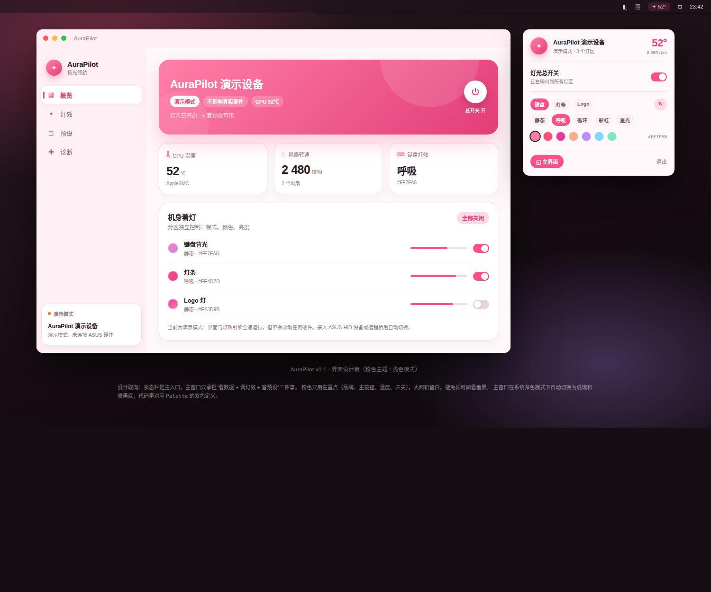

[README.md](https://github.com/user-attachments/files/35506099/README.md)
# AuraPilot · 极光领航

macOS 原生的 ASUS ROG 灯光控制工具。粉色系界面、菜单栏常驻，后台是一套**传输层可替换**的灯效引擎，面向黑苹果机型与 macOS 上的 ROG 笔记本。

> **先说结论**：Windows 上的 G-Helper 无法直接移植到 macOS——它是 C#/WinForms，笔记本灯光走 ACPI-WMI，而 XNU 内核没有这条栈。本项目在 macOS 侧**独立重写**了后台与界面，并把传输层做成可替换：USB HID（原生可用）/ 演示模式（无硬件时全速跑 UI）。详细论证见 [`docs/01-可行性报告.md`](docs/01-可行性报告.md)。



---


| 维度 | 说明 |
|---|---|
| 版本 | **v0.54**（2026-11-27） |
| 部署目标 | macOS 13.0+ |
| 架构 | Intel x86_64 原生；Apple Silicon 走 Rosetta 2 |
| 编译 | Swift 5.9 / Xcode 15+，无需 Homebrew、无需签名 |
| 构建标记 | `v0.54+ · G614JVR + ROG 状态栏合并 · 状态栏重绘` |

v0.54+ 主要变化：状态栏面板**全中文重绘**（去掉渲染异常的符号、风扇读数不截断）；开机自启开关**以系统登录项真实状态为准**，不再和「系统设置」里显示的不一致；补齐本发布文档与开源致谢。完整历史见 [`VERSION`](VERSION)。

---

## 功能一览

| 模块 | 状态 | 说明 |
|---|---|---|
| 灯效引擎 | ✅ | 9 种模式（静态 / 呼吸 / 循环 / 彩虹 / 星光 / 流星雨 / 高光扫过 / 激光 / 涟漪），软件渲染 + 固件内置效果双通道 |
| 协议包系统 | ✅ | JSON DSL（`$mode/$r/$g/$b/$brightness/$speed/$sum8`），改机型不用改代码；用户包放 `~/Library/Application Support/AuraPilot/protocols/` |
| HID 传输 | ✅ | `IOHIDDevice` 枚举 + Feature / Output 报告写入；主接口独占判定 + 掉线重打 + 设备看门狗 |
| 演示传输 | ✅ | 无硬件时全速跑通 UI 与引擎；开机比 USB 枚举早时自动重探真机并自愈 |
| 传感器 | ✅ | `ASUSFanSMC.kext` 直读 EC 三风扇 + AppleSMC 温度回退 + NVIDIA 显卡遥测；缺测显示「—」，不编造数字 |
| 配置与预设 | ✅ | JSON 原子写入、损坏自愈，内置预设 + 自定义 |
| 状态栏面板 | ✅ | 温度 / 三风扇 / 四档键盘背光 / 灯效预设 / 显示配置 / 五项状态栏开关 / 模式 / 颜色 / 主题 / 右键菜单 |
| 主窗口 | ✅ | 概览 / 灯效 / 预设 / 系统 / 设置 / 诊断 六页 |
| G533 小键盘 | ✅ | 触控板 5×4 映射为小键盘；独立「用户态服务」总开关，该开关关闭时，长按也开不了 |
| ROG 合并功能 | ✅ | 侧栏 ROG 头像、状态栏 ROG 徽标、系统遥测、GameVisual gamma、开机自启、关窗保持运行 |
| 界面主题 | ✅ | 跟随系统深浅色；樱花粉 / 浅粉 / 极简白 / 天青蓝 / 五彩缤纷五套主题 |
| 风扇曲线 / 功耗模式 | ❌ | macOS 不可达，明确不做（见可行性报告第 3 节） |
| AniMe Matrix | ❌ | 暂不支持 |

### 验证状态

| 部分 | 状态 |
|---|---|
| AuraCore 全模块 | Swift release 编译通过；56 个单测覆盖渲染器 / 灯效 / 引擎 / 配置 / 协议库 |
| App 层（SwiftUI / AppKit） | v0.54 release 编译通过（Intel x86_64） |
| 风扇读数 | 真机核对：`ASUSFanSMC.kext` 的 CPU 2820 / VGA 2700 / 3rd 3360 RPM 与 UI 一致；AppleSMC `F0Ac` 与之不符，故以 kext 为准 |
| 内置键盘协议包 | 按 G-Helper `Aura.cs` 与 macRogAuraCore 双向核对，报文布局有单测锁定 |
| 真机 | 已在 G614JVR（ROG Strix G16）+ N-KEY `0x19B6` 上实测 |

---

## 快速开始

### 方式一：打开现成的 App

桌面交付包 `AuraPilot-v0.54+-g614jvr.app`（或 `AuraPilot.app`），双击即可。首次打开若被 Gatekeeper 拦，右键 → 打开。

> 注意：本项目**刻意不签名**。macOS 26 上 ad-hoc 签名会被 TCC 按 cdhash 钉死到旧授权，导致 HID 权限失效；保持未签名才能按 bundle id 正常申请。

### 方式二：从源码编译

依赖：Xcode 15+ / Swift 5.9+、macOS 13+。**不需要 Homebrew**。

```bash
cd AuraPilot-v0.54-源码
./scripts/build-app.sh
# 只编译不打开： NO_OPEN=1 ./scripts/build-app.sh
# 前台跑看日志：  FOREGROUND=1 ./scripts/build-app.sh
```

脚本会从 `VERSION` 读版本号、做源码指纹校验、用系统 `swift build` 编译，组装成 `AuraPilot-v0.54-g614jvr.app` 放在桌面。

想用 Xcode 打开：仓库带 `AuraPilot.xcodeproj`；或用 XcodeGen 从 `project.yml` 重新生成（`make project`）。

命令行诊断工具：

```bash
cd Core
swift run aura-probe devices     # 枚举 HID 设备与匹配协议
swift run aura-probe fans        # 打印 kext 与 AppleSMC 原始风扇读数
swift run aura-probe sensors     # 读一次温度 / 风扇
swift run aura-probe frame --profile mac-rogauracore-keyboard --mode solid --color "#FF5C88" --bright 0.8
```

第一次启动会进入**演示模式**（不碰硬件），USB 键盘枚举完成后看门狗会自动连上真机。

---

## 权限说明

| 权限 | 什么时候需要 | 怎么给 |
|---|---|---|
| 输入监听（ListenEvent） | macOS 26 上 `IOHIDManagerOpen` 需要；灯控本身不发按键 | 系统设置 → 隐私与安全性 → 输入监控，勾上 AuraPilot，**重启 App** |
| 辅助功能 | G533 小键盘按键注入 / 光标冻结 | 系统设置 → 隐私与安全性 → 辅助功能 |
| 开机自启 | 可选 | 设置页打开「开机自启」；若出现「去系统设置批准」，点它到 系统设置 → 通用 → 登录项与扩展 → 登录时打开，勾上 AuraPilot |

> G533 用户态服务依赖上面两项权限。改完权限**一定要重启 App**，否则内核侧仍是旧授权。

---

## 支持的机型 / 设备

- **内置键盘（rogauracore 协议）**：PID `0x1854 / 0x1869 / 0x1866 / 0x19B6 / 0x1932`（GL553/GL753、GL503/FX503、GL703、GL504/GX501/GM501、GA503 幻15 等）。
- **G614JVR（ROG Strix G16）**：N-KEY `0x19B6` 单键盘区，PerKey；Logo / 灯条各有独立 HID 通道，但按键背光是实测可靠的那条。
- **G533 触控板小键盘**：VID `0x2808` / PID `0x0108`（ASUF1416）；需要 VoodooI2CHID 已驱动该触控板。
- **Falchion 外设**：PID `0x193C / 0x193E / 0x1B04 / 0x1B7E / 0x1A64 / 0x1ACE`（实验性，偏移未逐项校准）。
- 其它 `0x0B05:xxxx` 接口：把 PID 加进外置协议包的 `productIDs` 试一次，不用重编译。

---

## 项目结构

```
AuraPilot-v0.54-源码/
├─ App/                    SwiftUI / AppKit 界面层
│  ├─ StatusBar/           菜单栏图标、弹层、右键菜单
│  ├─ UI/                  主窗口六页、主题、头像
│  ├─ G533/                触控板小键盘
│  ├─ System/              系统遥测、显示配置
│  └─ Store/               UI 与引擎的桥
├─ Core/                   SwiftPM 包：纯逻辑 + 传输 + 传感器
│  ├─ Sources/AuraCore/    引擎、协议库、HID/SMC 传输、配置
│  └─ Sources/AuraProbe/   命令行诊断工具
├─ Bundle/                 Info.plist、图标、ROG 资源
├─ scripts/                build-app.sh 等构建脚本
├─ docs/                   可行性报告 / 架构 / 硬件协议笔记 / UI 预览
├─ project.yml             XcodeGen 配置
├─ VERSION                 完整版本历史
├─ ACKNOWLEDGEMENTS.md     开源致谢
└─ README.md
```

---

## 设计取舍

- **不仿 Windows 界面**：状态栏是主入口，主窗口分页，符合 macOS 习惯。
- **粉色是品牌色，不是满屏粉**：`#FF4F87` 主色，浅色底 `#FFF8FA`，深色自动降饱和。
- **不确定就不显示**：传感器读不到显示「—」，不会编造数字。
- **假功能不如没有**：风扇曲线、功耗模式明确标注不支持，不做「点了没反应」的按钮。
- **协议包外置**：真机适配是数据问题，不是代码问题。

## 已知限制

- 彩虹 / 星光等属于 G-Helper 的 WMI / Falchion 协议族，17 字节 rogauracore 没有对应模式码；N-KEY 实际通常只有静态真正生效。
- 逐键 `packetMap`（167 项）未移植；Falchion 偏移未逐项校准。
- 灯条 / Logo 的 WMI 通道在 macOS 不可达；状态锁走独立的 `5D BD` 帧，与灯效通道无关。
- 白天自动开关会把亮度压到 0，手动操作会临时接管（见 `VERSION` v0.18）。

---

## FAQ

**Q：状态栏图标怎么是黑色 / 看不见？**
A：v0.51 起 ROG 徽标固定白色 + 轻阴影，`isTemplate = false`。若仍异常，检查是否选了 emoji 字形。

**Q：改设置后键盘没反应？**
A：先看是不是白天自动熄灭了（设置页有横幅），点「立即点亮」即可；再看日志里有没有 `📤 下发` 与 `✅ 事务完成`。

**Q：小键盘长按没反应？**
A：三项都要对：辅助功能 + 输入监控已授权并**重启过 App**；设置页「G533 用户态服务」是开的；右键菜单里 G533 服务项有勾。

**Q：开机自启开关和系统设置不一致？**
A：v0.54 已修：开关只读 `SMAppService.mainApp.status`。若出现「去系统设置批准」，按提示跳转勾上即可，切回 App 会自动同步。

---

## 致谢

本项目的协议调研、报文核对与界面实现，站在了多个开源项目的肩膀上。完整清单（含许可证与证据文件）见 [`ACKNOWLEDGEMENTS.md`](ACKNOWLEDGEMENTS.md)。核心来源：

- **[G-Helper](https://github.com/seerge/g-helper)**（MIT）：ACPI-WMI 端点、Aura 模式码、Falchion / 电源锁位、逐键映射的核心参考。
- **[macRogAuraCore](https://github.com/black-dragon74/macRogAuraCore)**（BSD-3）：内置键盘 17 字节 Feature 协议、握手帧与速度查表。
- **[asus-numberpad-driver](https://github.com/asus-linux-drivers/asus-numberpad-driver)**：G533 触控板小键盘的 HID 命令与 5×4 坐标分区。
- **[ROG Gaming Center](https://www.asus.com/)**：状态栏功能、内置预设与图标资源来源。
- **OpenRGB / Linux asus-wmi / SMCNvidiaGPUStatus / ASUSFanSMC / VirtualSMC / VoodooI2C / SCIMKiller / NKeyBlocker** 等：协议交叉验证、传感器与驱动适配参考。
- **感谢workdubby Ai 协助写、整合代码。
- **感谢 [asus‑linux‑drivers/asus‑numberpad‑driver](https://github.com/asus-linux-drivers/asus-numberpad-driver) 启用触控版内置小键盘的适配项目以及该项目的所有作者。
---

## 免责声明

"ASUS"、"ROG"、"TUF"、"Armoury Crate" 均为华硕电脑股份有限公司的商标。本项目为个人非官方工具，与华硕无任何关联，仅出于互操作目的使用公开协议信息。修改灯光 / 硬件设置存在影响设备的风险，请自行评估。

## 许可证

本项目以 **GNU General Public License v3.0** 发布；上游各项目的许可证与归属见 [`ACKNOWLEDGEMENTS.md`](ACKNOWLEDGEMENTS.md)。
